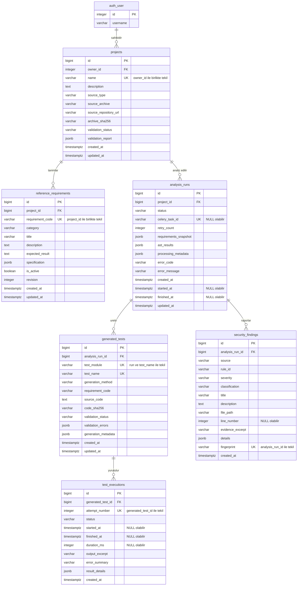

# Şema Doğrulama ve ER Diyagramı Sözleşmesi — H2-02 / Issue #24

Bu belge, `database_schema.sql`, `django_models.py` ve `data_dictionary.md` dosyalarının birbiriyle ve Issue #24 kabul ölçütleriyle tutarlılığını gösteren teknik inceleme ve devir belgesidir. ER diyagramı bu belgenin E bölümüne göre çizilir ve onunla karşılaştırılır.

---

## A. Varlık Kapsamı

| No | Mantıksal varlık | Tablo | Django modeli | Tanımlandığı yer | Durum |
|---|---|---|---|---|---|
| 1 | User | `auth_user` | `settings.AUTH_USER_MODEL` | Django `django.contrib.auth` | Django tarafından sağlanır; bu pakette yeniden tanımlanmaz. Sahiplik ilişkisi ve PK tipi veri sözlüğü 4.1'de belgelenmiştir. |
| 2 | Project | `projects` | `Project` | SQL bölüm 1, ORM, sözlük 4.2 | Tanımlı |
| 3 | ReferenceRequirement | `reference_requirements` | `ReferenceRequirement` | SQL bölüm 2, ORM, sözlük 4.3 | Tanımlı |
| 4 | AnalysisRun | `analysis_runs` | `AnalysisRun` | SQL bölüm 3, ORM, sözlük 4.4 | Tanımlı |
| 5 | GeneratedTest | `generated_tests` | `GeneratedTest` | SQL bölüm 4, ORM, sözlük 4.5 | Tanımlı |
| 6 | TestExecution | `test_executions` | `TestExecution` | SQL bölüm 5, ORM, sözlük 4.6 | Tanımlı |
| 7 | SecurityFinding | `security_findings` | `SecurityFinding` | SQL bölüm 6, ORM, sözlük 4.7 | Tanımlı |

Yedi temel varlık dışında ek tablo tanımlanmamıştır. Gereksinim sürümlemesi ek tablo yerine `reference_requirements.revision` ve `analysis_runs.requirements_snapshot` ile çözülmüştür.

## B. İlişki Matrisi

| Üst | Alt | FK sütunu → hedef | Çokluk | Alt FK NULL olabilir mi | Django `on_delete` | PostgreSQL FK davranışı | FK'yi kapsayan indeks |
|---|---|---|---|---|---|---|---|
| User | Project | `projects.owner_id → auth_user.id` | 1 : 0..N | Hayır | CASCADE | NO ACTION, DEFERRABLE INITIALLY DEFERRED | uq_projects_owner_name |
| Project | ReferenceRequirement | `reference_requirements.project_id → projects.id` | 1 : 0..N | Hayır | CASCADE | NO ACTION, DEFERRABLE INITIALLY DEFERRED | uq_reference_requirements_project_code |
| Project | AnalysisRun | `analysis_runs.project_id → projects.id` | 1 : 0..N | Hayır | CASCADE | NO ACTION, DEFERRABLE INITIALLY DEFERRED | ix_analysisrun_project_created |
| AnalysisRun | GeneratedTest | `generated_tests.analysis_run_id → analysis_runs.id` | 1 : 0..N | Hayır | CASCADE | NO ACTION, DEFERRABLE INITIALLY DEFERRED | uq_generated_tests_run_module_name |
| GeneratedTest | TestExecution | `test_executions.generated_test_id → generated_tests.id` | 1 : 0..N | Hayır | CASCADE | NO ACTION, DEFERRABLE INITIALLY DEFERRED | uq_test_executions_test_attempt |
| AnalysisRun | SecurityFinding | `security_findings.analysis_run_id → analysis_runs.id` | 1 : 0..N | Hayır | CASCADE | NO ACTION, DEFERRABLE INITIALLY DEFERRED | uq_security_findings_run_fingerprint |

Silme davranışı: zincirleme silme Django ORM tarafından yapılır; veritabanı, alt kaydı bulunan üst kaydın ham SQL ile silinmesini commit anında reddeder (veri sözlüğü 12.1, 14.2 F3).

TestExecution ile AnalysisRun arasında doğrudan yabancı anahtar yoktur. İlişki yalnızca `test_executions → generated_tests → analysis_runs → projects` zinciriyle kurulur; bu yüzden bir deneme, testinin ait olduğu çalıştırmadan başka bir çalıştırmaya bağlanamaz.

## C. SQL–ORM Tutarlılık Matrisi

### C.1 Tablo ve sütun düzeyi

| Tablo (`db_table`) | Model | Sütun sayısı (SQL / ORM / sözlük) | PK | Kontrollü değerler (CHECK ↔ TextChoices) | JSONB ↔ JSONField | Zaman damgaları |
|---|---|---|---|---|---|---|
| projects | Project | 12 / 12 / 12 | bigint identity ↔ BigAutoField | source_type: ARCHIVE, REPOSITORY; validation_status: PENDING, VALID, INVALID | validation_report (dict) | created_at (auto_now_add), updated_at (auto_now) |
| reference_requirements | ReferenceRequirement | 12 / 12 / 12 | bigint identity ↔ BigAutoField | category: AUTHENTICATION, AUTHORIZATION, INPUT_VALIDATION, HTTP_BEHAVIOR, SECURITY_CONFIGURATION | specification (dict) | created_at, updated_at |
| analysis_runs | AnalysisRun | 14 / 14 / 14 | bigint identity ↔ BigAutoField | status: QUEUED, ANALYZING, GENERATING, EXECUTING, COMPLETED, FAILED | requirements_snapshot (list), ast_results (dict), processing_metadata (dict) | created_at, started_at, finished_at, updated_at |
| generated_tests | GeneratedTest | 13 / 13 / 13 | bigint identity ↔ BigAutoField | generation_method: RULE_BASED, LLM, HYBRID; validation_status: PENDING, VALID, INVALID_SYNTAX, REJECTED_POLICY | validation_errors (list), generation_metadata (dict) | created_at, updated_at |
| test_executions | TestExecution | 11 / 11 / 11 | bigint identity ↔ BigAutoField | status: PENDING, RUNNING, PASSED, FAILED, ERROR, SKIPPED | result_details (dict) | created_at, started_at, finished_at |
| security_findings | SecurityFinding | 14 / 14 / 14 | bigint identity ↔ BigAutoField | source: BANDIT, DJANGO_CHECKLIST, AST_RULE; severity: INFO, LOW, MEDIUM, HIGH, CRITICAL; classification: CONFIRMED, POTENTIAL, INFORMATIONAL | details (dict) | created_at |

Toplam 76 sütun. Her sütunun tipi, `NULL` durumu ve `varchar` uzunluğu, SQL kataloğu ile ORM tanımı arasında otomatik olarak karşılaştırılmıştır (H bölümü).

### C.2 Adlandırılmış kısıt ve indeksler

| Tablo | Tekil kısıt / tekil indeks | CHECK kısıtları | Açık indeksler |
|---|---|---|---|
| projects | uq_projects_owner_name | ck_projects_name_not_blank, ck_projects_source_type_valid, ck_projects_validation_status_valid, ck_projects_archive_source_present, ck_projects_repository_source_present, ck_projects_source_archive_relative, ck_projects_archive_sha256_format | — |
| reference_requirements | uq_reference_requirements_project_code | ck_reference_requirements_code_format, ck_reference_requirements_category_valid, ck_reference_requirements_title_not_blank, ck_reference_requirements_expected_result_not_blank, ck_reference_requirements_revision_positive | — |
| analysis_runs | uq_analysis_runs_celery_task_id, uq_analysis_runs_one_active_per_project (kısmi) | ck_analysis_runs_status_valid, ck_analysis_runs_retry_count_non_negative, ck_analysis_runs_queued_not_started, ck_analysis_runs_progress_requires_start, ck_analysis_runs_finished_iff_terminal, ck_analysis_runs_time_order, ck_analysis_runs_failure_has_error_code | ix_analysisrun_project_created, ix_analysisrun_status_created |
| generated_tests | uq_generated_tests_run_module_name | ck_generated_tests_module_format, ck_generated_tests_name_format, ck_generated_tests_method_valid, ck_generated_tests_validation_status_valid, ck_generated_tests_code_sha256_format | — |
| test_executions | uq_test_executions_test_attempt | ck_test_executions_status_valid, ck_test_executions_attempt_positive, ck_test_executions_duration_non_negative, ck_test_executions_pending_not_started, ck_test_executions_running_started, ck_test_executions_terminal_finished, ck_test_executions_outcome_requires_start, ck_test_executions_time_order, ck_test_executions_duration_requires_finish | — |
| security_findings | uq_security_findings_run_fingerprint | ck_security_findings_source_valid, ck_security_findings_severity_valid, ck_security_findings_classification_valid, ck_security_findings_rule_id_not_blank, ck_security_findings_title_not_blank, ck_security_findings_file_path_relative, ck_security_findings_line_number_positive, ck_security_findings_fingerprint_format | ix_finding_run_severity |

Toplam 51 adlandırılmış kısıt/indeks; her biri SQL'de ve ORM `Meta` içinde aynı adla bulunur. Açık indeks adları Django'nun 30 karakter sınırına uygundur.

### C.3 Bilinçli farklar

PK/FK kısıt adları, sütun `DEFAULT` ifadelerinin konumu (veritabanı / Python), `updated_at` güncelleme mekanizması ve `CHECK` ifadelerinin metinsel yazımı iki dosya arasında farklıdır; anlam aynıdır. Ayrıntı ve çözüm: veri sözlüğü 14.2 (F1–F9).

## D. AnalysisRun Yaşam Döngüsü

### D.1 Geçiş matrisi

| Kaynak | Hedef | Tetikleyici | Zaman damgası değişikliği |
|---|---|---|---|
| (yeni) | QUEUED | API çalıştırma oluşturur, gereksinim anlık görüntüsünü yazar, görevi kuyruğa gönderir ve `celery_task_id`'yi kaydeder | created_at |
| QUEUED | ANALYZING | İşçi görevi alır | started_at = şimdi |
| ANALYZING | GENERATING | AST analizi tamamlanır, `ast_results` yazılır | — |
| GENERATING | EXECUTING | Testler üretilir ve doğrulanır | — |
| EXECUTING | COMPLETED | Yürütmeler ve güvenlik taramaları sonuçlanır | finished_at = şimdi |
| QUEUED | FAILED | İşçi başlamadan hata (ör. arşiv geçersiz, kuyruğa gönderilemedi) | finished_at = şimdi; started_at NULL kalır |
| ANALYZING / GENERATING / EXECUTING | FAILED | Aşama hatası, zaman aşımı veya işçi kaybı | finished_at = şimdi |

COMPLETED ve FAILED son durumlardır; geri geçiş yoktur. FAILED durumunda `error_code` zorunludur.

### D.2 Zorlama düzeyi

| Kural | Zorlayan |
|---|---|
| Durum altı değerden biridir | Veritabanı (`ck_analysis_runs_status_valid`) ve TextChoices |
| Durum ile `started_at` / `finished_at` tutarlıdır | Veritabanı (`ck_analysis_runs_queued_not_started`, `ck_analysis_runs_progress_requires_start`, `ck_analysis_runs_finished_iff_terminal`, `ck_analysis_runs_time_order`) |
| FAILED'da hata kodu vardır | Veritabanı (`ck_analysis_runs_failure_has_error_code`) |
| Projede tek aktif çalıştırma | Veritabanı (`uq_analysis_runs_one_active_per_project`) |
| Geçiş sırası (D.1) | Yalnızca uygulama katmanı: koşullu `UPDATE ... WHERE status = <beklenen>` veya `select_for_update()` |

Veritabanı `CHECK` kısıtları geçiş sırasını tek başına zorlamaz; satırın önceki değerini göremezler. Örneğin `COMPLETED` bir satırın `ANALYZING`'e döndürülmesi, `finished_at` aynı anda `NULL` yapılırsa kısıtlara takılmaz. Bu nedenle tüm durum değişiklikleri tek bir servis fonksiyonundan geçmelidir.

## E. ER Diyagramı Tanımı

### E.1 Varlıklar ve anahtar alanlar

| Varlık | PK | FK | Diyagramda gösterilecek diğer alanlar |
|---|---|---|---|
| User (`auth_user`) | id (integer) | — | username (Django alanı; yalnızca etiket amaçlı) |
| Project (`projects`) | id (bigint) | owner_id → User.id | name, description, source_type, source_archive, source_repository_url, archive_sha256, validation_status, validation_report, created_at, updated_at |
| ReferenceRequirement (`reference_requirements`) | id (bigint) | project_id → Project.id | requirement_code, category, title, description, expected_result, specification, is_active, revision, created_at, updated_at |
| AnalysisRun (`analysis_runs`) | id (bigint) | project_id → Project.id | status, celery_task_id, retry_count, requirements_snapshot, ast_results, processing_metadata, error_code, error_message, created_at, started_at, finished_at, updated_at |
| GeneratedTest (`generated_tests`) | id (bigint) | analysis_run_id → AnalysisRun.id | test_module, test_name, generation_method, requirement_code, source_code, code_sha256, validation_status, validation_errors, generation_metadata, created_at, updated_at |
| TestExecution (`test_executions`) | id (bigint) | generated_test_id → GeneratedTest.id | attempt_number, status, started_at, finished_at, duration_ms, output_excerpt, error_summary, result_details, created_at |
| SecurityFinding (`security_findings`) | id (bigint) | analysis_run_id → AnalysisRun.id | source, rule_id, severity, classification, title, description, file_path, line_number, evidence_excerpt, details, fingerprint, created_at |

### E.2 İlişkiler (crow's foot gösterimi)

| No | İlişki | Üst uç | Alt uç | Etiket |
|---|---|---|---|---|
| R1 | User — Project | tam bir (`\|\|`) | sıfır veya çok (`o{`) | sahibidir |
| R2 | Project — ReferenceRequirement | tam bir | sıfır veya çok | tanımlar |
| R3 | Project — AnalysisRun | tam bir | sıfır veya çok | analiz edilir |
| R4 | AnalysisRun — GeneratedTest | tam bir | sıfır veya çok | üretir |
| R5 | GeneratedTest — TestExecution | tam bir | sıfır veya çok | yürütülür |
| R6 | AnalysisRun — SecurityFinding | tam bir | sıfır veya çok | raporlar |

Diyagramda bulunmaması gereken ilişkiler: TestExecution — AnalysisRun, GeneratedTest — ReferenceRequirement, User ile Project dışındaki herhangi bir varlık arasında doğrudan çizgi, çoka çok ilişki.

### E.3 Mermaid tanımı

GitHub üzerinde doğrudan görüntülenebilir. Tiplerde uzunluk bilgisi Mermaid sözdizimi nedeniyle yazılmamıştır; uzunluklar veri sözlüğündedir.

## F. Dosyalar Arası Tutarlılık Kontrol Listesi

| Kontrol | Sonuç | Yöntem |
|---|---|---|
| Her SQL uygulama tablosu bir ORM modeline (`db_table`) karşılık gelir | Sağlandı (6/6) | Otomatik karşılaştırma |
| Her ORM alanı bir SQL sütununa karşılık gelir; tip, NULL durumu ve uzunluk aynıdır | Sağlandı (76/76) | Otomatik karşılaştırma |
| Her veri sözlüğü satırı gerçek şemadaki bir sütuna karşılık gelir; eksik sütun yoktur | Sağlandı (76/76) | Otomatik karşılaştırma |
| Her FK var olan bir tablo ve anahtara işaret eder | Sağlandı | DDL'in PostgreSQL'de çalıştırılması |
| Durum değerleri tüm dosyalarda aynıdır (AnalysisRun 6, TestExecution 6, GeneratedTest 4) | Sağlandı | Elle inceleme ve senaryo testleri |
| Her JSONB sütununun ORM karşılığı `JSONField`'dır (9 alan) | Sağlandı | Otomatik karşılaştırma |
| Adlandırılmış tekil/CHECK kısıtları ve açık indeksler iki dosyada aynı adla vardır (51) | Sağlandı | Otomatik karşılaştırma |
| `default=dict` / `default=list` kullanılır, değiştirilebilir sabit nesne varsayılanı yoktur | Sağlandı | Elle inceleme |
| `related_name` değerleri çakışmaz (projects, reference_requirements, analysis_runs, generated_tests, executions, security_findings) | Sağlandı | Elle inceleme |
| Belgelenen her ilişki ER diyagramında gösterilebilir ve E.2 ile örtüşür | Sağlandı | Elle inceleme |
| Gizli değer saklayan alan yoktur | Sağlandı | Elle inceleme |

### F.1 Uç senaryoların karşılanması

| No | Senaryo | Şemadaki karşılığı |
|---|---|---|
| 1 | Bir kullanıcı birden çok proje oluşturur | User 1:N Project; ad, sahip başına tekil. Test edildi. |
| 2 | Projenin henüz gereksinimi yok | İlişki alt taraftan zorunlu, üst taraftan isteğe bağlı; `requirements_snapshot = []`. Test edildi. |
| 3 | Projede birden çok bağımsız gereksinim | `(project_id, requirement_code)` tekil. Test edildi. |
| 4 | Proje birden çok kez analiz edilir | Project 1:N AnalysisRun; tamamlanan çalıştırmadan sonra yeni çalıştırma. Test edildi. |
| 5 | Kuyruktaki çalıştırmanın Celery görev kimliği henüz yok | `celery_task_id` NULL olabilir. Test edildi. |
| 6 | Çalıştırma başlar ve sonra başarısız olur | Aktif durumdan FAILED; `finished_at` ve `error_code` zorunlu. Başlamadan başarısız olma da test edildi. |
| 7 | Çalıştırma başarıyla tamamlanır | EXECUTING → COMPLETED, `finished_at` zorunlu. Test edildi. |
| 8 | Sözdizimi hatalı test yürütülmemeli | `validation_status = 'INVALID_SYNTAX'`; yürütme engeli uygulama kuralı (sözlük 7.2/2). Kaydın tutulması test edildi. |
| 9 | Test birden çok kez yürütülür | `(generated_test_id, attempt_number)`. Test edildi. |
| 10 | Doğrulama (assertion) başarısız | `status = 'FAILED'`, `error_summary`. Test edildi. |
| 11 | Altyapı hatası | `status = 'ERROR'`, `started_at` NULL olabilir. Test edildi. |
| 12 | Test atlanır | `status = 'SKIPPED'`. Test edildi. |
| 13 | Çalıştırmada güvenlik bulgusu yok | AnalysisRun 1:0..N SecurityFinding. Test edildi. |
| 14 | Farklı önem düzeylerinde çok sayıda bulgu | `severity` kontrollü değer, `ix_finding_run_severity`. Test edildi. |
| 15 | Gereksinim, önceki analizden sonra düzenlenir | `revision` artar; eski çalıştırma `requirements_snapshot` ile korunur. Sınır: kullanılmamış ara revizyonlar saklanmaz (sözlük 16/3). |
| 16 | Proje silinir | ORM CASCADE; veritabanı ham SQL ile alt kaydı olan üst kaydın silinmesini reddeder, alttan üste silme çalışır. Test edildi. Arşiv dosyası temizliği uygulama sorumluluğudur. |
| 17 | Kullanıcı başkasının projesine erişmemeli | Sahiplik zinciriyle sorgu süzme; FK tek başına yetkilendirme değildir (sözlük 13.1). Uygulama katmanı. |
| 18 | Celery yeniden denemesi / yinelenen teslim | Tekil `celery_task_id`, proje başına tek aktif çalıştırma, tekil test/deneme/bulgu anahtarları. Test edildi. |
| 19 | Yapılandırılmış analiz JSON'u boş | JSONB `NOT NULL`, boş durum `{}` / `[]`. Test edildi. |
| 20 | Arşivde şüpheli dosya adı veya sır | `validation_report.rejected_entries`; göreli yol kısıtları; sır değerleri saklanmaz, maskelenir. Yol kısıtları test edildi; içerik taraması uygulama katmanı. |

## G. Issue #24 Kabul Ölçütleri

| No | Kabul ölçütü | Karşılayan dosya ve bölüm |
|---|---|---|
| 1 | Gerekli tüm varlıklar ve ilişkiler tanımlanmıştır | `database_schema.sql` bölüm 1–6; `django_models.py` altı model ve `AUTH_USER_MODEL`; `data_dictionary.md` bölüm 3 ve 6; bu belge A ve B |
| 2 | PostgreSQL veri tipleri, PK/FK kısıtları ve önemli bütünlük kuralları belgelenmiştir | `data_dictionary.md` bölüm 4, 5, 7, 14; `database_schema.sql` kısıt tanımları; bu belge C |
| 3 | AnalysisRun durumları, Celery görev kimliği ve zaman damgaları eksiksiz tanımlanmıştır | `data_dictionary.md` 4.4 ve bölüm 8; `database_schema.sql` bölüm 3; `django_models.py` `AnalysisRun.Status`; bu belge D |
| 4 | Veri sözlüğü tüm tabloları ve sütunları kapsar | `data_dictionary.md` 4.1–4.7 (76 sütun ve `auth_user.id`); bu belge F |
| 5 | İlişkisel tasarım ER diyagramında tutarlı biçimde gösterilebilir | Bu belge E; `data_dictionary.md` bölüm 15 |
| 6 | Dosyalar GitHub deposuna eklenmeye hazırdır | `docs/database/` altındaki dört dosya; doğrulama durumu bu belge H |

İlgili gereksinimler İST-01, İST-03, İST-04, İST-07, İST-08, İST-09, İST-13 ve İST-15'tir. Bu gereksinimlerin metinleri bu pakette yer almadığından şema öğeleriyle tek tek eşleştirilmemiştir; eşleştirme gereksinim belgesi üzerinden yapılmalıdır.

## H. Doğrulama Durumu

| Kontrol | Durum | Ayrıntı |
|---|---|---|
| Tasarım incelemesi | Yapıldı | Yönergedeki kabul kapıları ve 20 uç senaryo üzerinden. |
| Referans SQL'in çalıştırılması | Yapıldı | PostgreSQL 16.15 üzerinde geçici bir veritabanında. `auth_user` yerine yalnızca `id integer` ve `username` sütunlarını içeren geçici bir tablo kullanıldı. DDL hatasız uygulandı; 6 tablo ve 16 indeks oluştu. |
| Kısıt davranış senaryoları | Yapıldı | Aynı veritabanında 59 senaryo (izin verilmesi ve reddedilmesi beklenen işlemler) çalıştırıldı; 59'u beklendiği gibi sonuçlandı. Senaryolar F.1'deki uç durumları ve her CHECK/UNIQUE kısıtını kapsar. |
| `django_models.py` Python sözdizimi | Yapıldı | `python -m py_compile` (Python 3.13) başarılı. |
| ORM–SQL otomatik karşılaştırması | Yapıldı | Modeller Python `ast` ile ayrıştırıldı ve PostgreSQL kataloğuyla (`information_schema.columns`, `pg_constraint`, `pg_indexes`) karşılaştırıldı: 76 sütunda tip, NULL durumu ve uzunluk; 51 adlandırılmış kısıt/indeks. Fark bulunmadı. Bu karşılaştırma Django'yu çalıştırmaz; ORM alanlarının PostgreSQL tiplerine dönüşümü Django'nun belgelenmiş eşlemesine göre yapılmıştır. |
| Django sistem kontrolleri (`manage.py check`) | Yapılmadı | Doğrulama ortamında Django paketi kurulamadı (paket deposuna erişim yoktu). |
| `makemigrations` / `sqlmigrate` çıktısının referans SQL ile karşılaştırılması | Yapılmadı | Aynı nedenle. |

Django ortamında yapılması gereken doğrulama adımları:

1. Modelleri uygulamanın `models.py` dosyasına taşıyın ve `python manage.py check` çalıştırın.
2. `python manage.py makemigrations` ile ilk migration'ı oluşturun.
3. `python manage.py sqlmigrate <app_label> 0001` çıktısında tablo, sütun, tekil/CHECK kısıt ve indeks adlarını bu belgenin C bölümüyle karşılaştırın. PK/FK adlarının farklı olması beklenir (sözlük 14.2 F1).
4. Boş bir test veritabanında `python manage.py migrate` çalıştırın ve modeller için temel oluşturma/silme testleri yazın; özellikle proje silindiğinde alt kayıtların ORM tarafından silindiğini doğrulayın.
